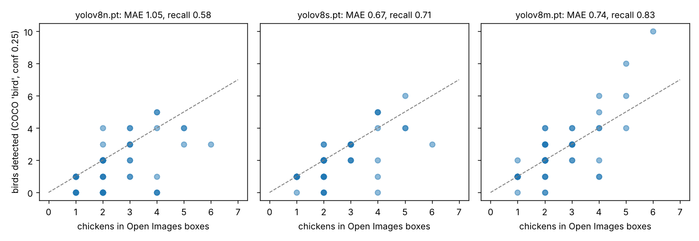
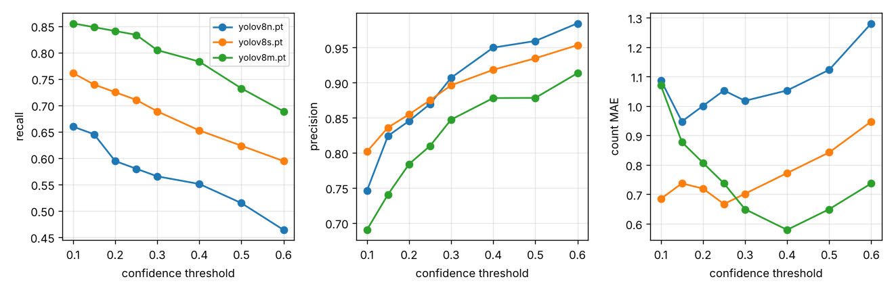
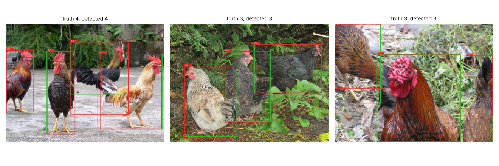
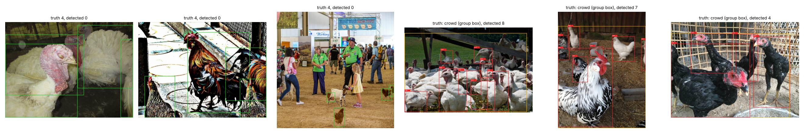
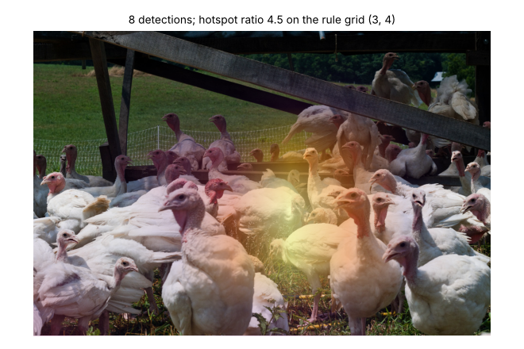
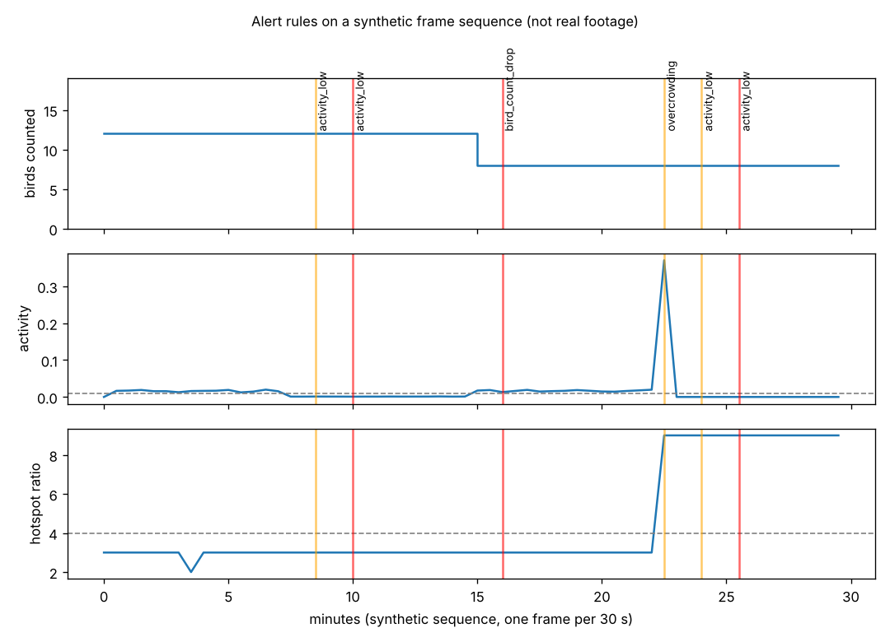

# poultry-vision-counting

Counts birds in poultry images with a pre-trained detector (Ultralytics YOLOv8, COCO class
`bird`, no fine-tuning), turns the detections into a density heatmap and a CSV, and feeds the
per-frame numbers to an alert engine that raises the same `vision_*` alert types the
[smart-poultry-farm](https://github.com/Mariam-zeqred/smart-poultry-farm) app stores in Firebase.
This repo shows what an off-the-shelf COCO detector can and cannot do on chickens, measured
against real bounding boxes, and where fine-tuning would have to start.

```
 data/manifest.csv ──fetch──> data/images/*.jpg (68 Open Images photos, CC BY 2.0)
                                     │
                                     ▼
              YOLOv8 (COCO "bird") ──> boxes ──┬──> count ───────────┐
                                              ├──> 6x8 density grid ─┤──> out/run/counts.csv
                                              └──> annotated PNGs     │      + annotated/
                                                                      ▼
   frames (count, hotspot ratio, activity) ──> rules.VisionAlertEngine ──> farm/alerts-shaped dicts
                                                                           vision_overcrowding
                                                                           vision_activity_low
                                                                           vision_bird_count_drop
                                                                           vision_stale
```

## Data

Roboflow Universe and Kaggle could not be reached from the build sandbox, so the image set
is drawn from [Open Images V7](https://storage.googleapis.com/openimages/web/index.html)
(annotations CC BY 4.0, photos CC BY 2.0 from Flickr). `data/manifest.csv` lists 68 photos
from the validation and test subsets that carry human-verified `Chicken` boxes, with the box
coordinates, author and source URL of each photo:

| kind | images | what it is |
|---|---|---|
| `multi` | 45 | 2–6 chickens, every bird boxed (126 boxes) |
| `single` | 12 | one boxed chicken (random sample of the 166 single-bird photos) |
| `flock` | 11 | a crowd covered by one "group of" box, so no per-bird truth |

The photos are not committed (24 MB); `make data` downloads them from the public Open
Images bucket. Most are backyard or free-range birds; only the `flock` images look like a
commercial poultry house. That is the main limitation of this evaluation and it is stated
again below.

## Run it

```bash
python -m venv .venv && . .venv/bin/activate
pip install -r requirements.txt          # CPU torch + ultralytics (~1 GB)
make check                               # ruff + 18 pytest tests (no network, no GPU)
make data                                # 68 photos -> data/images/
make run                                 # counts.csv + annotated images + heatmaps -> out/run/
make evaluate                            # detections vs Open Images boxes -> out/eval/
python -m poultry_vision evaluate --weights yolov8m.pt --conf 0.4   # try a bigger model
python -m poultry_vision alerts frames.csv --thresholds '{"capacity": 12}'  # replay a frame log
make figures                             # every PNG below + figures/results.json (~5 min CPU)
```

`yolov8n.pt` (6 MB) is downloaded by Ultralytics on first use.

## Results (produced by `make figures`, numbers in `figures/results.json`)

Detections are matched to the Open Images boxes one-to-one at IoU ≥ 0.5. Count error is
`detected − boxed` per image. `flock` images are excluded from these numbers because they have
no per-bird truth. 57 images, 138 boxed chickens, confidence threshold 0.25, 640 px:

| model | size | recall | precision | count MAE | count bias | exact count |
|---|---|---|---|---|---|---|
| yolov8n | 6 MB | 0.58 | 0.87 | 1.05 birds | −0.81 | 39 % of images |
| yolov8s | 22 MB | 0.71 | 0.88 | 0.67 | −0.46 | 54 % |
| yolov8m | 52 MB | 0.83 | 0.81 | 0.74 | +0.07 | 53 % |



The nano model, which is the one that fits an edge box, misses four birds in ten and
under-counts on average by almost one bird per photo. Lowering the confidence threshold
does not recover them: at 0.1 its recall is still 0.66 and its count MAE never drops below
0.95 (figure 02). The medium model reaches recall 0.83 but starts inventing birds
(precision 0.81), and even it only gets the exact count on half of the photos.



What works: well-separated adult birds in daylight, side-on, at a size the COCO training
set would call "a bird".



What fails, and why a COCO "bird" detector is the wrong tool for a poultry house
(figure 04, left to right):

1. **Close-up, overlapping white birds in a barn: 0 of 4 found.** COCO birds are mostly small
   wild birds and photographs of single animals; big white bodies filling the frame with no
   visible outline do not match that prior.
2. **A heavily processed photo: 0 of 4.** Colour and texture are far from any training image.
3. **A crowded fair scene: 0 of 4.** The chickens are tiny and the model's attention goes to
   the people.
4. **Crowds (the `flock` images): 4–8 detections where there are dozens.** The detector finds
   the few birds nearest the camera and gives up on the packed middle. On the eleven flock
   images yolov8n reports 2.7 birds on average and produces no detection outside the crowd
   box, so it is not hallucinating, it is blind to density.



The density heatmap is a 6×8 grid of detection centres with a Gaussian blur, and the
alert rules use a coarser 3×4 grid for the "hotspot ratio" (peak cell ÷ mean cell; 1 is even
spread, 12 is everyone in one cell). On the flock image with the most detections:



## Alert rules

`rules.py` emits dicts with the fields the app's `farm/alerts/{pushId}` records use
(`type`, `severity`, `message`, `value`, `threshold`, `createdAt`, `deviceId: "vision-ai"`,
`params`) and the vision types and threshold names listed in that repo's Firebase schema
(`hotspotSpikeRatio`, `activityLowSustainedCount`, `birdCountDropPct`,
`birdCountSustainedCount`, `staleMinutes`). The rule logic is this repo's interpretation,
because the app's own `vision_alert_engine` is not public:

| alert | fires when | severity |
|---|---|---|
| `vision_overcrowding` | count > capacity, or hotspot ratio > `hotspotSpikeRatio` with ≥ 2 birds | warning; critical above 1.25 × capacity |
| `vision_activity_low` | mean centre movement between frames < threshold for N consecutive frames | warning at N, critical at 2N |
| `vision_bird_count_drop` | count below baseline × (1 − drop %) for N consecutive frames | critical |
| `vision_stale` | no frame for `staleMinutes` (checked from a timer) | warning |

Alerts fire on the rising edge only and again if a warning escalates to critical; when a
condition clears the engine records it in `engine.resolved` so the app can set `resolvedAt`.
There is no video in the data set, so `scripts/demo_alerts.py` drives the engine with a
**synthetic** 30-minute sequence (birds jitter, freeze, four vanish, then huddle in a corner):



## Limitations

- The detector is COCO's generic `bird` class; nothing here was trained on chickens.
- 68 photos, mostly backyard birds, one or a few per frame. Commercial-house images are the
  eleven `flock` photos, and those have no per-bird truth, so the numbers above say little
  about a real house with 20 000 birds.
- Open Images boxes are not exhaustive for crowds (that is what group boxes mean), so flock
  precision cannot be measured either, and a few photos labelled `Chicken` there arguably
  show turkeys (figure 05 is one); the labels were taken as given.
- Activity needs consecutive frames of the same camera. The demo sequence is fabricated and
  the thresholds are placeholders to be tuned on real footage.
- CPU only; inference time on an edge device was not measured.

## Next steps

- Fine-tune yolov8n on a labelled poultry-house set (a few hundred images are enough to
  start) and rerun `make evaluate`; the evaluation code does not change.
- Replace box counting with density-map regression for packed houses, where boxes stop
  making sense.
- Run on a short real clip from the poultry house to set `activityLow` and the hotspot
  threshold from data instead of guesses.
- Export the fine-tuned model to ONNX or TFLite and measure inference time on the target
  board.
